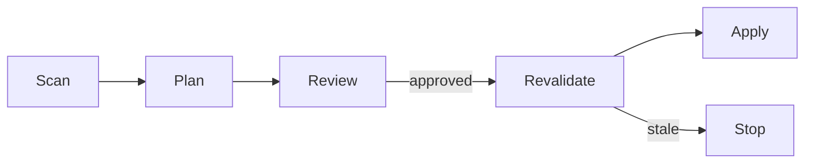

# RFC 0001: Plan-first `config setup`

- **Status:** Proposed
- **Date:** 2026-08-27
- **Decision:** Replace the imperative `init` flow with reviewed Oxlint, Oxfmt, and Lefthook setup for pnpm repositories.

## Scope and review

The [current ESLint initializer](../../packages/eslint/src/init.ts) installs packages and writes files before review. This RFC proposes one replacement command:

```text
config setup [--cwd <directory>] [--yes]
```

Resolve `--cwd` to the Git repository root, not a workspace leaf. Require a root `package.json` with `packageManager: "pnpm@…"` and an available pnpm executable. Allow a missing lockfile; refuse foreign or ambiguous lockfiles, non-Git directories, and unsupported hook layouts before changes.

Show a unified diff for text changes, the exact package and hook-install commands, and the hook target. Explain pnpm's effects on the manifest, lockfile, and `node_modules`, which have no predictable static diff, and the formatter's future staging behavior. Ask for approval after review; `--yes` skips only the prompt, not review or safety checks.

Decline or conflict means no command or write. Other package managers, including Nub, are deferred. No integration chooser, TUI, or `--force` is needed.

## Plan and apply



Scan the manifest, lockfile, config aliases and overlays, file bytes or absence, symlinks, and effective Git hook path and contents. A pure planner returns text changes, commands as executable plus argv, and conflicts or unchanged notes. Review and apply consume the same plan.

Keep one pnpm/Oxlint/Oxfmt/Lefthook flow, without an adapter registry, action graph, or persisted plan. Use Effect at file, process, and terminal boundaries; `Data.TaggedEnum` is optional internal modeling, not a reason to add services.

Own only generated baselines and the two named Lefthook commands. Never overwrite author-owned configs, follow escaping symlinks, or change unrelated YAML bytes. A different command with either name conflicts; setup process commands use argv, while Lefthook `run` uses a shell string.

## Config discovery

- **Oxlint:** Scan root `.oxlintrc.json`, `.oxlintrc.jsonc`, `oxlint.config.ts`, and `oxlint.config.mts` ([lookup](https://oxc.rs/docs/guide/usage/linter/config)). With none, create `oxlint.config.ts` using the [documented baseline](../../packages/oxlint/README.md). Require Node 22.18+ or 24+ for this TS config. An exact generated baseline is unchanged on rerun; other existing configs, including TS/MTS, conflict without execution or edits. Multiple root names conflict.

- **Oxfmt:** Scan root `.oxfmtrc.json`, `.oxfmtrc.jsonc`, `oxfmt.config.ts`, and `oxfmt.config.mts` ([lookup](https://oxc.rs/docs/guide/usage/formatter/config.html)). With none, create `.oxfmtrc.json` containing only `"$schema": "./node_modules/oxfmt/configuration_schema.json"`. Preserve one valid JSON/JSONC config; refuse invalid content, multiple names, or TS/MTS whose behavior requires execution. Leave nested configs alone and do not promise one policy for every file.

- **Lefthook:** Scan all [documented main names](https://lefthook.dev/configuration/) in the root and `.config`: `lefthook.yml`, `.yaml`, `.toml`, `.json`, and `.jsonc`, plus root dot-prefixed names. Scan the corresponding `lefthook-local` overlays, including local-only setups. Multiple main files or any overlay conflict; create `lefthook.yml` only when none exist.

For an existing Lefthook config, accept one YAML main with mapping-shaped `pre-commit.commands`, including an absent mapping that can be inserted safely. Refuse other formats, `jobs`, duplicate keys, anchors/aliases/merges at the insertion path, and composition or settings that can replace or skip the planned commands, such as `extends` or `remotes`. Report unsupported shapes, preserve unrelated bytes, and accept existing named commands only when they match the planned entries.

## Formatter and staging policy

Add named `oxlint` and `oxfmt` pre-commit commands for staged JS/TS files matching `*.{js,cjs,mjs,jsx,ts,cts,mts,tsx}`. Oxlint lints these files; Oxfmt writes them and Lefthook [`stage_fixed: true`](https://lefthook.dev/configuration/stage_fixed/) stages the fixes. Do not replace this behavior with `--check`.

Before formatting or staging, reject any matched staged file that also has unstaged changes. The user must stage or set aside those changes first. Without this check, `stage_fixed` can include initially unstaged hunks.

The check must run before Lefthook hides unstaged content. Lefthook 2.2.2 auto-stashes it before command execution, so a command-level `git diff` guard does not enforce this refusal. Specify behavior here rather than unverified shell syntax; prove the check and [filename expansion](https://lefthook.dev/configuration/run/) with the selected release before implementation ships.

Disclose fix-and-stage behavior and partially staged refusal in the setup review.

## Packages and hook activation

Install missing dev dependencies `oxlint`, `@macklinu/oxlint-config`, `oxfmt`, and `lefthook` with versions tested at CLI release. Use `pnpm add -D --ignore-scripts`, adding `--workspace-root` only at a pnpm workspace root. Keep compatible declared dependencies; incompatible versions or unclear dependency locations conflict rather than trigger upgrades.

If dependencies are declared but not installed, review `pnpm install --ignore-scripts`. Verify the installed tools before proceeding. [`@macklinu/oxlint-config` requires Oxlint >=1.70.0](../../packages/oxlint/package.json).

Before package commands, resolve Git's effective hook path. Refuse configured `core.hooksPath`, linked worktrees with shared hooks, symlinked hook targets, and unmanaged `pre-commit` files. Recognize a managed hook by its Lefthook-generated wrapper, not by an arbitrary mention of Lefthook; never reset hook settings or remove another tool's hook.

`--ignore-scripts` suppresses automatic hook installation. After applying configs, recheck the target and explicitly run [`pnpm exec lefthook install pre-commit`](https://lefthook.dev/usage/commands/install/) for an absent or recognized managed hook that needs installation or refresh. Leave an already active managed hook unchanged.

Verify that the effective `pre-commit` file is executable and Lefthook-managed. An inactive hook or installation failure is setup failure, even when packages and configs changed. Hook installation changes Git state outside the text diff.

## Revalidation and failures

Before apply, rescan every reviewed input and compare it with the plan, including config aliases, overlays, file bytes or absence, symlinks, hook ownership, and chosen argv. If anything changed, stop for a new review. Recheck config discovery and each text target before replacement, and the hook before installation.

Run package commands, verify their results, atomically replace approved text files, then activate and verify the hook. Treat pnpm's manifest/lockfile edits as expected command effects, not stale patches to replay. These steps are not one atomic operation.

On failure, stop and report completed commands, changed files, and remaining work. Do not roll back package changes or overwrite concurrent edits. A rerun plans from current state; a CLI lock cannot replace stale checks because it does not block external tools.

## Verification and limits

Use fixtures with independent expected diffs and conflicts. In a disposable Git repo, exercise review, approval, package installation, config creation, and an active pre-commit hook. Check decline without side effects, rerun without duplicates, stale changes before and during apply, unsupported configs and hook layouts, install failure, and partial-result reporting.

Exercise the installed hook with multiple staged JS/TS files and a space-containing filename. Prove successful formatting and staging, plus partially staged refusal without changing the index or files. Do not install test hooks in this repository's checkout.

Workspace leaves, other managers, author-owned Oxlint config edits, non-YAML Lefthook edits, overlay edits, profile selection, and OpenTUI review are outside this slice. Unsupported state fails clearly rather than running a smaller, unreviewed setup.
